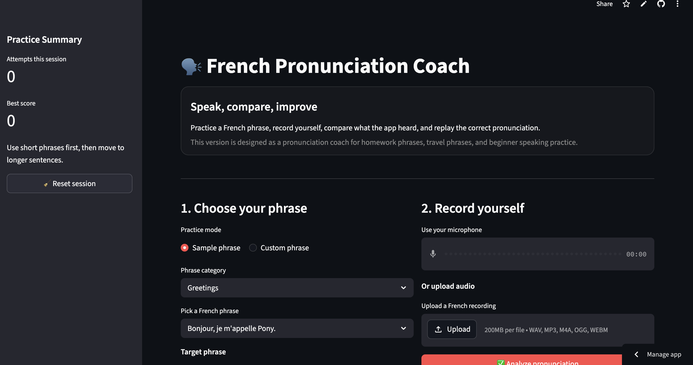

# French Pronunciation Coach



A Streamlit app that helps learners practice French pronunciation by recording their voice, transcribing what the app hears, comparing the spoken result to a target phrase, and giving simple feedback with a replayable model pronunciation.

---

## Overview

**French Pronunciation Coach** is a speaking-practice app built to help learners improve their French pronunciation in a simple and repeatable way.

The app lets you choose a French phrase, record yourself speaking it, and compare your spoken result to the target phrase. It then shows what the app heard, gives a similarity score, highlights matched and missing words, and lets you replay the correct pronunciation.

This project was built as a companion app to my **French Homework App**.

- **French Homework App** helps with reading, vocabulary, exercises, flashcards, and quiz practice
- **French Pronunciation Coach** helps with speaking and pronunciation practice

Together, they form a small French learning app ecosystem.

---

## Features

- Practice with **sample French phrases**
- Type your own **custom French phrases**
- Record directly with your **laptop microphone**
- Upload audio files for pronunciation practice
- Transcribe spoken French with the OpenAI Audio API
- Compare the spoken result to the target phrase
- Show a pronunciation similarity **score**
- Display **matched**, **missing**, and **extra / unclear** words
- Generate and play the **correct pronunciation audio**
- Track **recent attempts** during the current session
- Reset the session and start fresh

---

## How It Works

1. Choose a sample phrase or type your own French phrase
2. Record yourself speaking the phrase
3. Let the app transcribe what it heard
4. Compare the spoken phrase against the target text
5. Review the score and feedback
6. Replay the correct pronunciation
7. Try again and improve your result

---

## Tech Stack

- **Python**
- **Streamlit**
- **OpenAI Audio API**

---

## Project Structure

```text
french-pronunciation-coach/
├── .streamlit/
│   └── secrets.toml
├── app.py
├── requirements.txt
├── README.md
└── .gitignore
